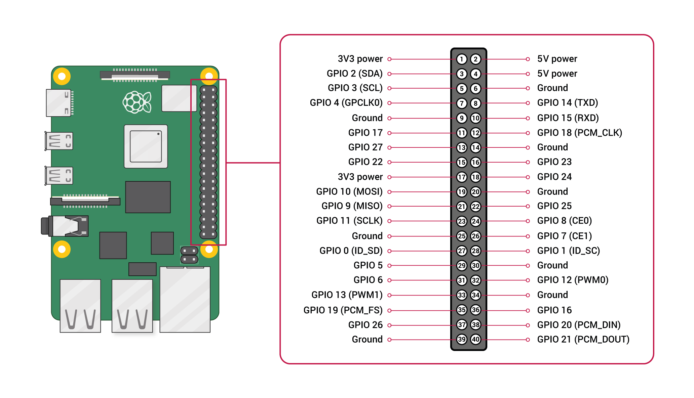

# Readers

A reader is an outbound adapter that detects NFC tags and returns their UID to the jukebox.

Select a reader with `--reader`:
```shell
jukebox --player PLAYER --reader READER
```

You can also persist the choice so you don't need to pass it each time:
```shell
jukebox-admin settings set jukebox.reader.type READER
```

> [!TIP]
> Tag UIDs are returned in colon-separated hex format: `xx:xx:xx:xx`.

Available readers:
- [Dry Run](#dry-run-dryrun)
- [Pn532 NFC](#pn532-nfc-pn532)

## Dry Run (`dryrun`)

Simulates NFC tag reading via stdin. Useful for development when no NFC hardware is available.

Input format: `tag_id` or `tag_id duration_seconds`

- `tag_id`: full identifier of the tag in the system's colon-separated hex format
- `duration_seconds`: non-negative float; how long the tag stays in place before being removed (default: `immediate`)

Example: `your:tag:uid 2.5`

No configuration required.

### Persistent settings

| Settings path | Description | Value |
| --- | --- | --- | 
| `jukebox.reader.type` | Persists the reader choice across restarts | dryrun |

## Pn532 NFC (`pn532`)

Reads physical NFC tags using a PN532 reader.

### Supported hardware

- NFC reader: **PN532** (e.g. [Waveshare PN532 NFC HAT](https://www.waveshare.com/wiki/PN532_NFC_HAT), HiLetGo PN532 V3)
- NFC tags: **NTAG2xx**

### Installation

The `pn532` extra is required:

```shell
pip install "gukebox[pn532]"
```

> [!IMPORTANT]
> On Python 3.13+, use the **system Python** and install `python3-lgpio` from your OS package manager before creating your virtual environment:
> ```shell
> sudo apt update && sudo apt install python3-lgpio
> python3 -m venv --system-site-packages jukebox
> source jukebox/bin/activate
> pip install "gukebox[pn532]"
> ```
> A separately installed Python 3.13+ (from `uv`, `pyenv`, Homebrew, etc.) may not be able to import the system `lgpio` package even with `--system-site-packages`. Use the system Python or Python 3.12 or lower instead.

### Hardware setup

Enable the SPI interface on the Raspberry Pi:

```shell
sudo raspi-config
# Interface Options > SPI > Enable > Yes
```

> [!NOTE]
> Wire using physical pin numbers; `cs`, `reset` and `irq` settings use BCM numbers. Some diagrams use WiringPi numbers instead (e.g. physical pin 7 labelled "GPIO 7" is GPIO4 in BCM). See the [Raspberry Pi pin layout](https://www.raspberrypi.com/documentation/computers/raspberry-pi.html#pin-layout), or run `pinout` on the Pi.



*Diagram © Raspberry Pi Ltd, [CC BY-SA 4.0](https://creativecommons.org/licenses/by-sa/4.0/), from the [Raspberry Pi documentation](https://github.com/raspberrypi/documentation/blob/master/documentation/asciidoc/computers/raspberry-pi/gpio-on-raspberry-pi.adoc).*

### Wiring

The reader drives SS (chip select) itself, on the GPIO given by `cs`.

> [!IMPORTANT]
> Do not wire SS to pin 24 (GPIO8 / CE0). GPIO8 is already claimed by the kernel SPI driver (`/dev/spidev0.0`), so probing fails with `GPIO busy` ([#261](https://github.com/Gudsfile/jukebox/issues/261)).

### Board profiles

A board profile sets default GPIO pin numbers for your hardware. Three profiles are available:

| Profile | `reset` | `cs` | `irq` |
| --- | --- | --- | --- |
| `waveshare_hat` | 20 | 4 | — |
| `hiletgo_v3` | — | 4 | — |
| `custom` | — | — | — |

*`—` means the pin is not connected by default. `custom` has no defaults.*

Wire the hardware as described in [Wiring](#wiring) before probing.

```shell
# List profiles and their defaults
jukebox-admin pn532 profiles

# Select a profile (interactive)
jukebox-admin pn532 select

# Select a profile directly
jukebox-admin pn532 select --profile waveshare_hat

# After selecting a profile and wiring the hardware, verify the connection
jukebox-admin pn532 probe
```

This connects to the PN532, prints the firmware version, and attempts one tag read.

### Persistent settings

| Settings path | Description | Default |
| --- | --- | --- |
| `jukebox.reader.type` | Persists the reader choice across restarts | `pn532` |
| `jukebox.reader.pn532.read_timeout_seconds` | Timeout in seconds for each NFC poll attempt (must be > 0) | `0.1` |
| `jukebox.reader.pn532.board_profile` | GPIO pin preset (`waveshare_hat`, `hiletgo_v3`, `custom`) | `waveshare_hat` |
| `jukebox.reader.pn532.protocol` | Communication interface (`spi`) | `spi` |
| `jukebox.reader.pn532.spi.reset` | BCM pin for the reset line; `null` uses the profile default | profile default |
| `jukebox.reader.pn532.spi.cs` | BCM pin for chip select; `null` uses the profile default | profile default |
| `jukebox.reader.pn532.spi.irq` | BCM pin for IRQ line; `null` uses the profile default | profile default |

Override a pin without changing the profile, or reset it to the profile default:

```shell
jukebox-admin settings set jukebox.reader.pn532.spi.cs 17
jukebox-admin settings reset jukebox.reader.pn532.spi.cs
```

## Another reader?

The best way to contribute is to add support for the reader yourself. We’d be happy to review your pull request.

If you’re unsure how to proceed, feel free [to open an issue](https://github.com/Gudsfile/jukebox/issues/new) describing the reader you’d like to support, someone may be able to guide you.
